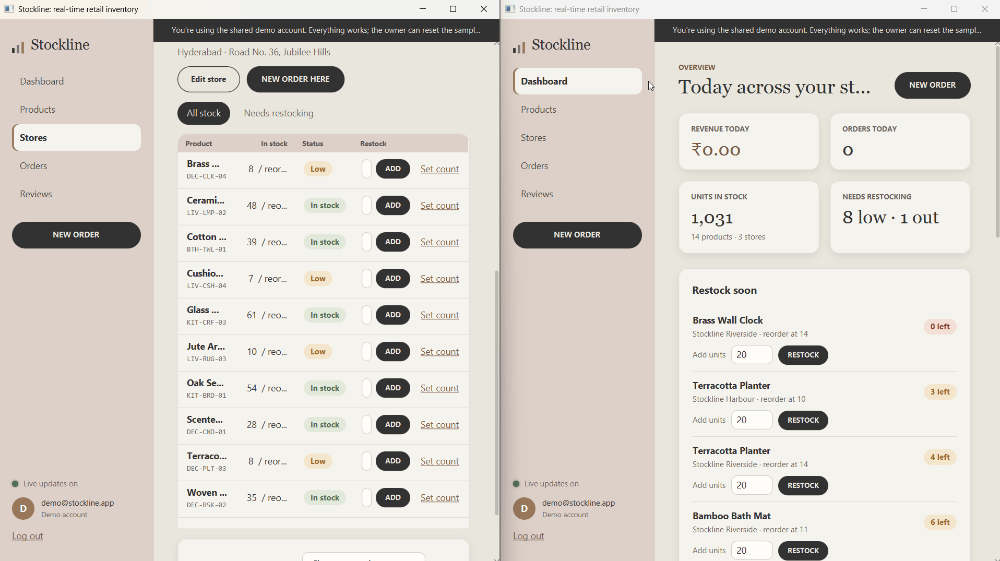

# Stockline Desktop

A real-time retail inventory app for the desktop, built with **JavaFX** and **JDBC** on **MySQL**.
Run it on two computers against the same database, sell something on one, and the other updates
within seconds: stock levels, alerts, the dashboard and the activity feed.



> Demo account (created automatically): `demo@stockline.app` / `demo1234`

## What it shows

**JDBC and SQL**
- DAO pattern with `PreparedStatement` everywhere (no string-built SQL)
- **Transactions**: an order locks each stock row with `SELECT … FOR UPDATE`, checks and takes stock,
  writes the order and items, then `commit()`; any shortage triggers `rollback()`
- **Stored procedure** `sp_restock`, called with `CallableStatement`, which raises `SIGNAL SQLSTATE '45000'` on bad input
- **View** `v_inventory_status` with a computed stock status (`CASE`)
- Batch inserts (`addBatch` / `executeBatch`), generated keys, `ON DUPLICATE KEY UPDATE` upserts
- Reports with `JOIN`, `LEFT JOIN`, derived tables, `GROUP BY`, `NOT EXISTS` and time-zone-aware date grouping
- Schema with foreign keys (`CASCADE` / `SET NULL`), `CHECK` constraints, unique keys and indexes

**JavaFX**
- Dashboard (revenue, orders, stock alerts, 7-day sales chart, best sellers, live activity),
  Products, Stores with stock management, Orders with a multi-item order dialog, and Reviews
- All database work runs on background threads so the window never freezes
- Styled entirely with JavaFX CSS (Narvik, beige, dark grey and Sorrell brown palette)

**Real time**: every change writes to an `activity` table; each running app polls it every 2 seconds
with one indexed query and refreshes the open page, with a notification.

**Security**: passwords hashed with PBKDF2-HMAC-SHA256 (210,000 iterations, per-user salt).

## Run it

1. Install **JDK 21** and **MySQL 8.0.16+** (MySQL Community Server).
2. Start the app:
   ```bash
   ./mvnw javafx:run          # macOS / Linux
   .\mvnw.cmd javafx:run      # Windows
   ```
3. On first run, enter your MySQL host, port, username and password. The `stockline` database,
   tables, view, stored procedure and sample data are created for you.
4. Log in with the demo account, or create your owner account on the login screen.

### Build a double-clickable jar
```bash
./mvnw package               # creates target/stockline-desktop.jar for your operating system
java -jar target/stockline-desktop.jar
```

## Project structure
```
src/main/java/com/bharat/stockline
├── app/         Startup (JavaFX Application) and jar launcher
├── db/          Connection settings, schema installer, password hashing
├── dao/         JDBC data access: stores, products, inventory, orders, reviews, reports, users
├── service/     Order transaction, demo data, live feed
├── model/       Records
├── ui/          Main window, login, setup, shared UI helpers
└── ui/views/    Dashboard, Products, Stores, Orders, Reviews and dialogs
src/main/resources/com/bharat/stockline
├── db/schema.sql    Tables, view and stored procedure
└── ui/stockline.css JavaFX styles
```
